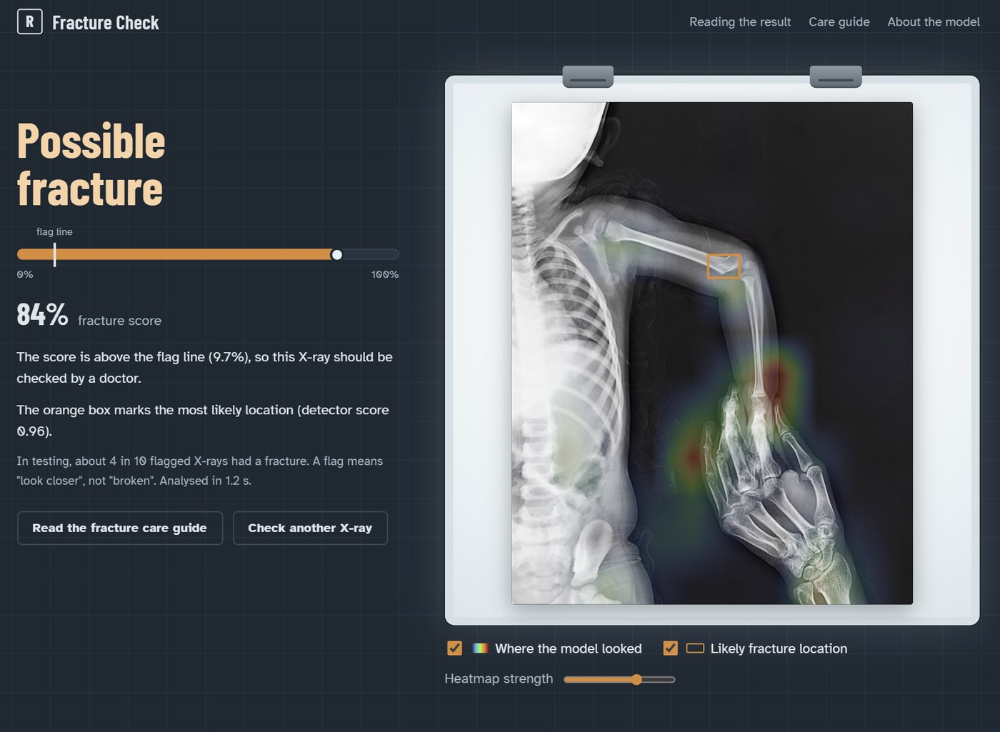

# Bone Fracture Detection from X-rays (FracAtlas)

[](https://github.com/Akinchan-Jain-7/fracatlas-fracture-detection/actions/workflows/ci.yml)
[](https://huggingface.co/spaces/akinchanJain7/fracture-check)
[](https://huggingface.co/akinchanJain7/fracture-detection-model)
[](LICENSE)

Screens hand, arm, leg and hip X-rays for fractures. A ConvNeXt-Tiny classifier
scores the X-ray against a threshold fixed before testing, Grad-CAM shows where it
looked, and a Faster R-CNN detector marks where the break most likely is. Trained
and evaluated on the [FracAtlas](https://doi.org/10.6084/m9.figshare.22363012)
dataset (4,083 X-rays, about 18% fractured), with a leakage-safe split and a test
set scored once.

**Try it:** [Fracture Check on Hugging Face](https://huggingface.co/spaces/akinchanJain7/fracture-check)
(upload an X-ray; the free Space may take a minute to wake up).



*The live app on a FracAtlas X-ray (CC BY 4.0). The score is checked against a flag line
fixed before testing; the heatmap shows where the classifier looked and the orange box
is the detector's most likely fracture location. The two can disagree, as here: how often
each lands on the radiologist's fracture box is measured in [Phase 6](docs/phase-6-explainability.md)
and [Phase 7](docs/phase-7-localization.md).*

**Not a medical device. For education and research only.**

## Results

Current model: ConvNeXt-Tiny (ImageNet-22k pretrained), fine-tuned on grayscale 384 px X-rays.
It replaced the ResNet-50 baseline after winning a seeded comparison on validation (Phase 5).
**Test set (589 X-rays, 102 fractured), scored once**, with a threshold fixed on validation beforehand:

| Metric | Value [95% CI] | ResNet-50 baseline | Meaning |
|---|---|---|---|
| Recall | **0.922** [0.859, 0.976] | 0.892 | 94 of 102 fractures found |
| Specificity | **0.708** [0.643, 0.764] | 0.548 | 7 in 10 normal X-rays are cleared |
| Flagged per 100 X-rays | 40 | 53 | about a quarter fewer false alarms to review |
| PR-AUC | **0.853** [0.776, 0.914] | 0.739 | 5× the random baseline (0.17) |
| PR-AUC without surgical hardware | 0.825 | 0.695 | the gain is not just the metal shortcut |

Known weak spots: normal hand X-rays are still mostly flagged (specificity 0.30), and leg
recall is 0.80 (24 / 30). Details are in [Phase 5](docs/phase-5-models.md).

**Where it looks** ([Phase 6](docs/phase-6-explainability.md)): Grad-CAM heatmap peaks land on the
radiologist's fracture box in 22.5% of test fractures, against 7.8% for an "image centre" guess
and 1% by chance. None of the 18 fractures the model missed (10 validation, 8 test) had the
heatmap on the fracture: the misses are fractures the model never located, mostly in legs.

**Where the fracture is** ([Phase 7](docs/phase-7-localization.md)): a box detector's top box lands on
the fracture in 74.5% of test fractures, and marks 72 of the 94 fractures the classifier flags.
It is unreliable on X-rays with surgical hardware, where it boxes the implant.

**How these numbers were kept honest:**
- **Leakage-safe split.** Near-duplicate and likely same-patient images never cross splits (Phase 1).
- **Threshold pre-registered.** It was chosen on validation and committed to git before the test set was opened. The evaluation script refuses to run otherwise (Phase 3).
- **Patient-level uncertainty.** The confidence intervals resample whole patient groups: 102 fractures come from only 47 groups.
- **Seeded comparisons.** Model changes are compared over 3 seeds on validation, with the selection rule fixed before the runs. Weighted loss, oversampling and focal loss all failed that test (Phase 4). The new backbone passed it and was then confirmed by its own single test evaluation (Phase 5).
- **Plans before runs.** The Grad-CAM analysis and the detector's training and test protocol were committed before they were run (Phases 6 and 7).

## How it was built

Each phase has a write-up with the method, the numbers, what went wrong and interview Q&A.

| Phase | Result |
|---|---|
| [0 Setup](docs/phase-0-setup.md) | Installable package, YAML configs, seeding, checksum-verified data download, CI |
| [1 Data](docs/phase-1-data.md) | EDA, shortcut checks, near-duplicate detection, leakage-safe grouped split |
| [2 Baseline](docs/phase-2-baseline.md) | ResNet-50 transfer learning: validation PR-AUC 0.714, ROC-AUC 0.869 |
| [3 Evaluation](docs/phase-3-evaluation.md) | Threshold pre-registered on validation, test scored once: recall 0.892 at specificity 0.548, PR-AUC 0.739 |
| [4 Class imbalance](docs/phase-4-imbalance.md) | Weighted loss, balanced sampler and focal loss, 3 seeds each: **none helped**, baseline kept |
| [5 Model comparison](docs/phase-5-models.md) | 4 challengers × 3 seeds: **ConvNeXt-Tiny won** (validation PR-AUC 0.709 → 0.814) and was confirmed on test (table above) |
| [6 Explainability](docs/phase-6-explainability.md) | Grad-CAM scored against radiologist boxes: pointing-game 0.225 vs 0.010 chance; random-weight sanity check passed; heat follows surgical hardware |
| [7 Localisation](docs/phase-7-localization.md) | Faster R-CNN on the fracture boxes: top box on the fracture 0.745 (Grad-CAM 0.304), AP50 0.421 with normal X-rays included |
| [8 Web app](docs/phase-8-app.md) | FastAPI app with a care guide, Docker image tested in CI, [live on Hugging Face](https://huggingface.co/spaces/akinchanJain7/fracture-check) |

## Run the app locally

```bash
git clone https://github.com/Akinchan-Jain-7/fracatlas-fracture-detection.git
cd fracatlas-fracture-detection
pip install -e ".[serve]" huggingface_hub
hf download akinchanJain7/fracture-detection-model \
    classifier_convnext_tiny_s44.pt detector_s42_best.pt --local-dir models

uvicorn app.main:app --port 8000
# or with Docker:
docker build -t fracture-check . && docker run --rm -p 8000:7860 -v "$PWD/models:/app/models:ro" fracture-check
```

Then open http://localhost:8000. The app checks both model files' SHA-256 and training
provenance before it answers. More in [docs/phase-8-app.md](docs/phase-8-app.md).

## Reproduce the experiments

```bash
python -m venv .venv && source .venv/bin/activate   # Windows: .venv\Scripts\activate
pip install -e ".[dev]"

python scripts/download_data.py          # ~340 MB from Figshare, checksum-verified
python scripts/verify_data.py            # checks layout and counts
python scripts/make_split.py --verify    # rebuilds the split, checks it matches splits/
pytest                                   # unit tests
```

Training ran on Kaggle GPUs: see [docs/phase-0-setup.md](docs/phase-0-setup.md) and
[`notebooks/kaggle_runner.ipynb`](notebooks/kaggle_runner.ipynb). Every run is defined by a
config in `configs/`, and every reported number is copied from run output into `results/`.

## Repository layout

```
src/fracdet/  installable Python package: data, models, training, evaluation,
              explainability (Grad-CAM), detection, serving
configs/      YAML configs; every run and analysis plan is a config file
scripts/      command-line entry points (download, split, train, evaluate, explain, ...)
notebooks/    thin Kaggle runners; no core logic lives in notebooks
splits/       the committed train/val/test split (identical on every machine)
results/      metrics, reports and per-image outputs of every reported run
docs/         per-phase write-ups, figures and interview Q&A
app/          FastAPI service and web frontend (Fracture Check)
deploy/       Hugging Face model card and Space files
tests/        pytest unit tests, run in CI on every push
Dockerfile    the app's container image (built and smoke-tested in CI)
```

## Dataset citation

Abedeen, I., Rahman, M. A., Prottyasha, F. Z., et al. *FracAtlas: A Dataset for
Fracture Classification, Localization and Segmentation of Musculoskeletal
Radiographs.* Scientific Data 10, 521 (2023). Data licensed CC BY 4.0.

## License

Code: MIT. Dataset: CC BY 4.0 (not redistributed here).

Built by Akinchan Jain, B.Tech CSE (AI), Bennett University.
