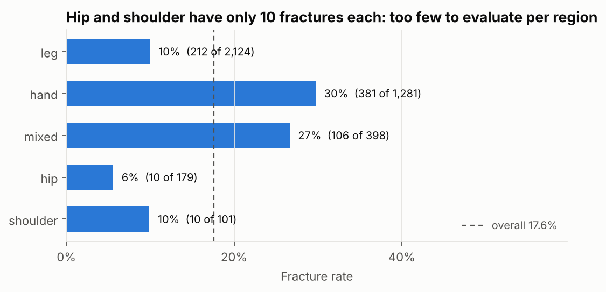
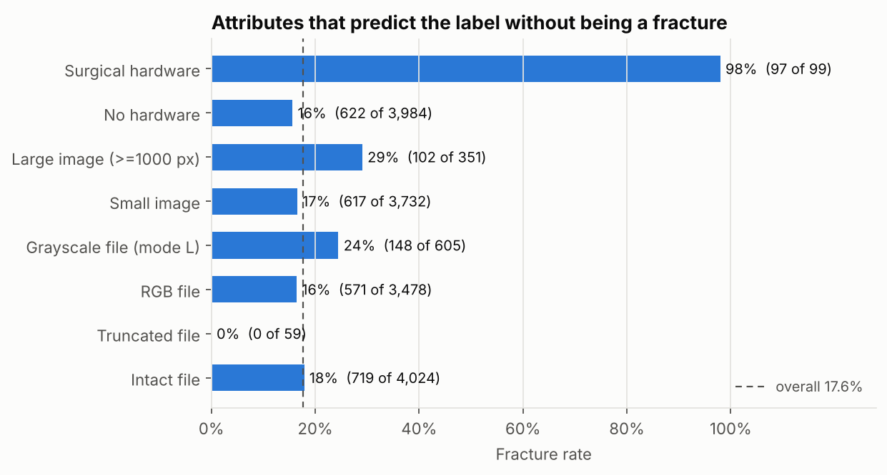
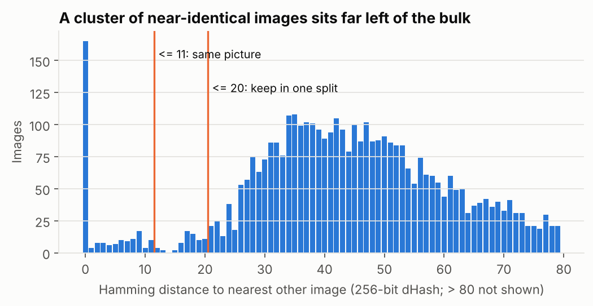
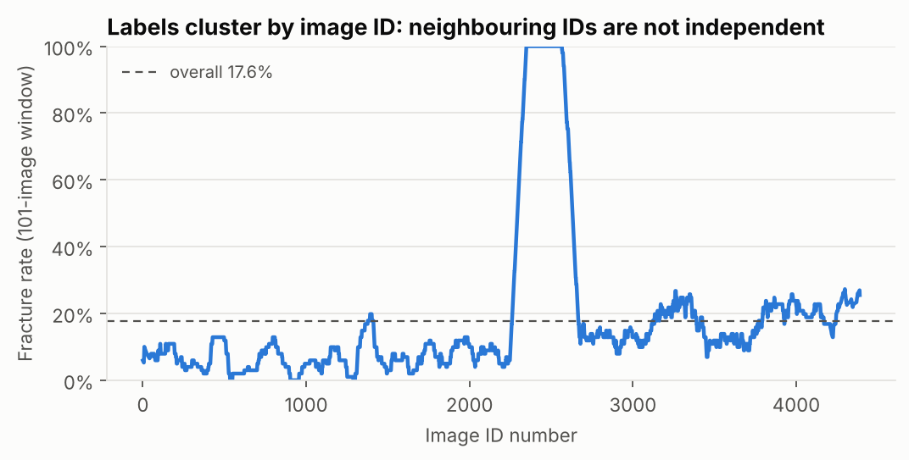

# Phase 1: Data understanding and a leakage-safe split

**Goal:** know the dataset well enough that no later number can be fooled by
it, then freeze one train/val/test split that every phase uses.

**Outcome:** `splits/split_v1.csv`: 3,917 usable images split 70/15/15
(2,742 / 586 / 589) with a near-identical fracture rate in each part
(17.6% / 17.4% / 17.3%). 166 images excluded, each with a recorded reason.

All numbers below come from the Figshare v7 archive (MD5
`fe9da2c7c285915ebee69dfdab8fd396`), run on 2026-11-03.

---

## 1. Files added

| Path | Purpose |
|---|---|
| `src/fracdet/data/schema.py` | Column and folder names in one place. |
| `src/fracdet/data/metadata.py` | `load_metadata(root)`: one clean row per image, with the label from the CSV, the path from the matching label folder, and readable `region` / `view` keys. Every later phase starts here. |
| `src/fracdet/data/integrity.py` | Finds files that don't fully decode (truncated JPEGs). |
| `src/fracdet/data/duplicates.py` | MD5 exact duplicates; 256-bit dHash near-duplicates; chunked Hamming distances; union-find grouping. |
| `src/fracdet/data/split.py` | Exclusions → groups → stratified group folds (own implementation) → 70/15/15; `check_split` enforces the leakage rules. |
| `src/fracdet/data/eda.py` | EDA statistics as plain data (unit-tested). |
| `scripts/make_split.py` | Builds the split; `--verify` rebuilds and checks it matches the committed file. |
| `scripts/eda.py` | Writes `summary.json` and the four figures below. |
| `splits/split_v1.csv`, `splits/split_v1_summary.json` | **The split, committed.** |
| `docs/figures/phase-1/` | Figures and the full EDA summary JSON. |

---

## 2. What the data looks like

| | Value |
|---|---|
| Images | 4,083 |
| Fractured | 719 (**17.6%**) |
| Accuracy of always predicting "no fracture" | **82.4%** |
| Views | frontal 2,199 · lateral 1,188 · oblique 366 · multiple 330 |
| Image sizes | bimodal: 3,732 small (373×454 or 454×373) vs 351 large (≥ 2,140 px) |
| Fractures per positive image | 1: 548 · 2: 146 · 3: 17 · 4: 7 · 5: 1 |
| YOLO boxes | every fractured image has a box file whose box count equals `fracture_count` (719/719); every non-fractured file is empty (3,364) |

The `region` key: one body part flagged → that part; several parts or the
`mixed` flag → `mixed`. (`mixed` never appears without two or more parts.)
**Hip and shoulder have only 10 fractures each.** After splitting, the test set
holds 1 hip and **0 shoulder** fractures, and validation 2 and 0: all 10 shoulder
fractures sit in a few groups that landed in train. Per-region results for those
two would be noise (or impossible), so later reports show hand, leg and mixed only,
and state that **shoulder fracture detection is not tested**.

---

## 3. Findings that changed the design

### 3.1 Shortcuts: attributes that predict the label without being a fracture

- **Surgical hardware:** 97 of 99 hardware images are fractured (98%). A model
  can learn "metal → fracture". Hardware is clinically real, so it stays in, but
  **from Phase 3 on, every metric is also reported on non-hardware images**, and
  Grad-CAM (Phase 6) checks where the model looks.
- **Image size / file mode:** large images are 29% fractured vs 17%; grayscale
  files 24% vs 16%. These track the source hospital or batch. Resizing removes
  the size itself, but not resampling artefacts. Phase 5 error analysis reports
  results by size group.
- **Truncated files: 59, all non-fractured** (IDs 4028–4347). They decode with
  flat grey bars at the bottom (47 of the 59 visibly so). "Grey bar → healthy" is
  a perfect shortcut, so **they are excluded**.

### 3.2 Duplicates, and duplicates with contradictory labels

- **12 groups of byte-identical files (27 images)** under different IDs, e.g.
  `IMG0000003` = `IMG0000005` = `IMG0002291` = `IMG0002293`.
- Many more **re-encoded copies**: same picture, different bytes, sometimes with
  an "L"/"R" marker added or removed. Many IDs above 4000 are copies of images in
  the 2600–3000 range.
- **Some copies disagree on the label**, e.g. `IMG0002886` (fractured) and
  `IMG0004243` (not), Hamming distance 0. We can't know which label is right.

**Why a 256-bit hash:** the textbook 64-bit dHash gave 221 images a "perfect
match" when only 27 have a byte-identical copy. At 9×8 pixels, X-rays all look
the same. 256 bits (16×16) separates them.

**How the two thresholds were chosen (by looking, not guessing):** I rendered
pairs at each distance band. Intact pairs fall into **0–11** (every one the same
picture) and **16–20** (similar but different: consecutive shots, similar knees),
with **no pairs at 12–15**. So:

| Threshold | Meaning | Action |
|---|---|---|
| ≤ 11 | same picture | keep one copy; if copies disagree on the label, drop all |
| ≤ 20 | similar | keep in the same split |

Copies of truncated files land at 9–17 because the grey bar adds distance.
That's harmless, since truncated files are excluded anyway.

### 3.3 Neighbouring IDs behave like one patient

FracAtlas has **no patient IDs**, but the ID order carries information:

- After a fractured image, the next ID is fractured **74%** of the time (base rate 18%).
- Fractured images come in short runs. The most common run length is **2**
  (160 runs), consistent with a frontal + lateral pair of one patient, e.g.
  `IMG0003375` (frontal) and `IMG0003376` (lateral), both fractured hands.
- IDs ~2300–2650 contain a run of **316 consecutive fractured images**: a
  fracture-only collection batch.

A random split would put one view of a fracture in train and the other in test.
**So runs of consecutive IDs with the same label and region are grouped and kept
in one split.** This is a heuristic: it can't prove two images share a patient,
but over-grouping only costs a little stratification precision, while
under-grouping inflates the test score.

---

## 4. The split

1. **Exclude:** 13 images from duplicate groups with conflicting labels (2 of
   them also truncated), 57 further truncated files, and 96 extra copies of
   duplicated images. **166 total** (all 59 truncated files are out).
2. **Group:** near-duplicates (≤ 20) ∪ consecutive same-label-and-region runs →
   1,520 groups, largest 24 images.
3. **Split:** stratified group k-fold makes 20 folds of ~5%, each stratified on
   `label × region` and never splitting a group. A seeded shuffle assigns 3 folds
   to test, 3 to val and 14 to train. The fold assignment is our own NumPy
   implementation (`assign_folds`), not scikit-learn's. See 4.1 for why.
4. **Check:** `check_split` raises if a group spans two splits or a duplicate
   group has more than one used image.

| Split | Images | Fractured | Rate | Fractured by region | Hardware + fractured |
|---|---|---|---|---|---|
| train | 2,742 | 483 | 17.6% | hand 250, leg 145, mixed 71, shoulder 10, hip 7 | 70 |
| val | 586 | 102 | 17.4% | hand 54, leg 31, mixed 15, hip 2 | 12 |
| test | 589 | 102 | 17.3% | hand 54, leg 30, mixed 17, hip 1 | 11 |

**Why commit the split:** the test set must be identical on Kaggle, this laptop
and CI, and must never change after results are reported on it.
`make_split.py` refuses to overwrite without `--force`, and `--verify` proves a
machine rebuilds it exactly.

### 4.1 Reproducibility bug: same seed, different split

The first `split_v1` used scikit-learn's `StratifiedGroupKFold`. Rebuilding it on
Kaggle with `make_split.py --verify` gave **1,805 images a different split**. The
stage-by-stage report showed exclusions, duplicate groups and split groups
identical (so hashing is stable across Pillow 12.3 and 13.0), and **only the fold
assignment differed**: scikit-learn 1.6.1 (Kaggle) and 1.9.1 (local) produce
different folds for the same seed and input.

Fix: `assign_folds` implements the same greedy algorithm in about 40 lines of
NumPy, and a golden-output test freezes its behaviour. The split was regenerated
**before any model was trained on it**; from Phase 2 on it is frozen.

Lesson: a random seed only guarantees reproducibility *for the same code*.
Library upgrades change the code. That's why the split is a committed file, not
something recomputed at training time, and why `--verify` exists.

**Test-set size and uncertainty:** 102 positives means a measured recall of 80%
has a 95% confidence interval of roughly ±8 percentage points. Phase 3 reports
bootstrap confidence intervals, not bare point estimates.

---

## 5. Limitations (stated in the final README)

- No patient IDs: same-patient grouping is inferred from ID adjacency.
- Label noise exists: identical images with opposite labels. We excluded the
  ones we found; copies we couldn't match may still carry noise.
- Hip and shoulder are too small to evaluate on their own.
- Batch effects (size, file mode, the 316-image fracture-only batch) may be
  learnable. Phases 5–6 test for them.
- Three hospitals in one country; no chest, skull or spine; fracture cases skew male.

---

## 6. Interview questions

**Q: What is data leakage, and where could it happen in this dataset?**
Information about test examples reaching training, so the test score overstates
real performance. In FracAtlas: the same image under two IDs, the same patient's
other view, and label-correlated artefacts (grey bars on truncated negatives).
Leakage doesn't throw errors. It just makes numbers look better than reality.

**Q: Why not `train_test_split(stratify=y)`?**
It treats every image as independent. Here they aren't: copies and same-patient
views would land on both sides. Stratified *group* k-fold keeps whole groups
together while still balancing the label × region mix.

**Q: How do you find near-duplicates?**
dHash: shrink to 17×16 grayscale, compare each pixel with its right-hand
neighbour, which gives 256 bits. The Hamming distance between hashes measures
visual similarity, robust to JPEG re-encoding and resizing. I chose thresholds
by viewing pairs at each distance, and found a natural gap at 12–15.

**Q: Why exclude the truncated images instead of keeping them?**
All 59 are negatives and decode with grey bars. The model could learn "grey bar
→ healthy" and score well without seeing bone. Losing 1.8% of negatives is cheap.

**Q: Your test set has 589 images. Is that enough?**
For the overall score, yes, with confidence intervals (about ±8 points on recall
with 102 positives). Per region, no: the test set has 1 hip and 0 shoulder
fractures, so I don't report them separately, and I say shoulder is untested.

**Q: You fixed the seed. How could the split still differ between machines?**
A seed fixes the random numbers, not the algorithm consuming them. scikit-learn
1.6.1 and 1.9.1 turn the same seed into different folds. I found it with a
verify step that rebuilds the split on Kaggle and compares stage by stage, then
replaced the library call with my own implementation plus a golden-output test.
And training reads the committed split file, so it never depends on recomputation.

**Q: Why 20 folds?**
The fold step produces k roughly equal folds; whole folds then go to splits. With
k = 20, each fold is 5%, so 70/15/15 = 14/3/3 folds exactly.

**Q: Why is accuracy a bad metric here?**
Always answering "no fracture" scores 82.4% while missing every fracture. We
care most about missed fractures (false negatives), so Phase 3 centres on
recall/sensitivity, precision, PR-AUC and a threshold tuned on validation.
