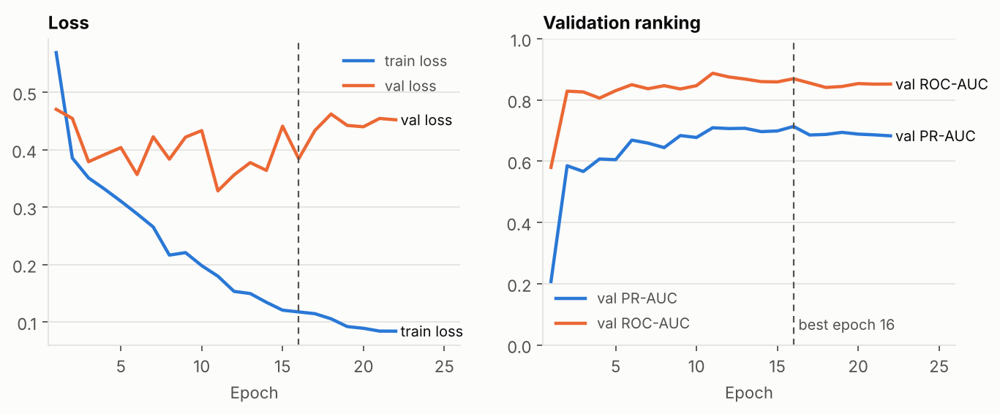

# Phase 2: Baseline model

**Goal:** a correct, reproducible training pipeline and a first honest number:
an ImageNet-pretrained ResNet-50 fine-tuned on `split_v1`, with no
imbalance tricks. Every later improvement (Phase 4 imbalance handling, Phase 5
backbones) is measured against this run.

**The test set is not used in this phase.** All numbers below are on
**validation** (586 images, 102 fractured).

## Result (validation, best epoch 16 of 22)

| Metric | Value | For reference |
|---|---|---|
| **PR-AUC** | **0.714** | random ranking ≈ 0.174 (the positive rate) |
| ROC-AUC | 0.869 | random = 0.5 |
| Recall @ 0.5 | 0.559 (57 / 102 fractures found) | |
| Precision @ 0.5 | 0.803 (57 of 71 alarms real) | |
| Specificity @ 0.5 | 0.971 (470 / 484 normals cleared) | |
| Accuracy @ 0.5 | 0.899 | "always normal" scores 0.826 on this val set |

Run: `configs/baseline_resnet50.yaml`, commit `a579c9f`, Tesla T4 with AMP,
31 s/epoch, 11.8 min, early-stopped at epoch 22. Re-scoring `best.pt` from disk
gave the same PR-AUC (0.7136). Records: `results/phase2_baseline_resnet50/`;
raw files and checkpoint: Kaggle notebook version 1 output.



### What the numbers say

1. **The model has learned real signal.** PR-AUC 0.71 is four times the random
   baseline, and ROC-AUC 0.87 means a random fractured image outranks a random
   normal one 87% of the time.
2. **At threshold 0.5 it misses 44% of fractures.** For a screening tool that's
   the wrong trade-off: missing a fracture is worse than a false alarm. 0.5
   is arbitrary for an imbalanced problem. **Phase 3 picks the threshold on
   validation to reach a target recall**, using `val_predictions.csv`.
3. **Overfitting starts early.** Training loss falls from 0.57 to 0.08, while
   validation loss bottoms out around epoch 6–11 and validation PR-AUC
   plateaus at ~0.70 from epoch 11. Early stopping and best-epoch selection
   handle it for now. Stronger augmentation, label smoothing or a smaller head
   LR are Phase 4/5 candidates, compared against this run.
4. **The validation score is now slightly optimistic.** We picked the best of 22
   epochs *by* validation PR-AUC, so validation is no longer an unbiased
   estimate. Epoch-to-epoch swings of ±0.01–0.02 with only 102 positives are
   mostly noise. That's why the **test set** (untouched) gives the honest
   number in Phase 3.
5. **The GPU waits on the CPU.** Kaggle's CPU meter was pegged while the GPU
   wasn't. Decoding and augmenting on 4 cores is the bottleneck, so caching
   pre-resized images is a cheap Phase 5 speed-up.

---

## 1. Files added

| Path | Purpose |
|---|---|
| `src/fracdet/data/transforms.py` | Grayscale + fast JPEG draft decode, letterbox to a square, augmentation, normalisation; one config dict builds train and eval pipelines. |
| `src/fracdet/data/dataset.py` | `load_split_frames` (reads the committed split; only the splits you ask for) and `FracAtlasDataset` returning `(image, label, index)`. |
| `src/fracdet/models/classifier.py` | `timm` backbone with a single-logit head. |
| `src/fracdet/train/metrics.py` | PR-AUC, ROC-AUC, recall / precision / specificity at 0.5. |
| `src/fracdet/train/schedule.py` | Per-batch linear warmup + cosine decay. |
| `src/fracdet/train/engine.py` | One training epoch (AMP, grad clipping) and one prediction pass. |
| `src/fracdet/train/checkpoint.py` | Checkpoint = weights + model config + preprocessing + provenance; atomic save. |
| `src/fracdet/train/fit.py` | The driver: loaders, optimiser, epochs, early stopping, best checkpoint, run record. |
| `scripts/train.py`, `scripts/show_run.py` | Train from a config; print a run's table. |
| `configs/baseline_resnet50.yaml` | This run's settings. |
| `tests/test_dataset_model.py`, `tests/test_training.py` | Transform geometry, RGB==grayscale, determinism, metric values, schedule shape, checkpoint round-trip, tiny-batch overfit, end-to-end `fit`, and "test split never requested". |

---

## 2. Design decisions

**Grayscale for every image.** FracAtlas mixes RGB and grayscale files, and
grayscale files are more often fractured (24% vs 16%, Phase 1). Converting all
of them to one channel removes that shortcut. The channel is then repeated ×3
because the network was pretrained on colour ImageNet images. A test checks
that an RGB file and its grayscale version give identical tensors.

**Letterbox, not stretch.** Resize the long side to 384 px and pad to a square
with black. Stretching a 373×454 X-ray into a square would distort bone
geometry. 384 stays close to the native resolution of most images (454 px),
because fractures can be hairline-thin.

**Augmentation without random crops.** Flip, ±10° rotation, ±5% shift, 0.9–1.1
zoom, brightness/contrast ±20%: plausible variations of a real radiograph. A
random crop can remove the fracture while the label still says "fractured",
which teaches the model wrong labels.

**Transfer learning.** ResNet-50 pretrained on ImageNet already detects edges,
textures and shapes. We replace its 1,000-class head with one output (the
fracture logit) and fine-tune the whole network. 3.3k training images are far
too few to learn those filters from scratch.

**One logit + `BCEWithLogitsLoss`.** Binary task → one probability,
`sigmoid(z)`. The loss fuses sigmoid and log for numerical stability (no
`log(0)`).

**AdamW, no weight decay on biases/normalisation.** Weight decay regularises
the conv and linear weights; on BatchNorm scales and biases it only distorts
the normalisation, so they are exempt (standard practice).

**Warmup + cosine.** The new head starts random. One epoch of LR warmup keeps its
large early gradients from wrecking the pretrained backbone. Cosine decay
then lowers the LR smoothly to 1% of its peak.

**Mixed precision (AMP).** Float16 matrix maths on the T4's tensor cores,
float32 weights; `GradScaler` prevents tiny float16 gradients from underflowing
to zero. Gradients are clipped *after* un-scaling, so the clip threshold applies
to the real gradient.

**Best epoch by validation PR-AUC.** Not accuracy (82% for a model that never
predicts a fracture) and not loss (it can improve while ranking gets worse).
PR-AUC is threshold-free and focused on the positive class. Early stopping
after 6 epochs without improvement.

**Checkpoints carry their own preprocessing.** `best.pt` stores the weights,
model name, image size and normalisation, git commit, split name and split-file
MD5. The web app (Phase 8) loads one file and rebuilds everything, so no
constants are copied between training and serving. After training, `fit`
reloads `best.pt` from disk and re-scores validation, which proves the file
reproduces the reported number.

**The test split is never loaded.** `fit` asks only for `train` and `val`, and a
unit test spies on the loader to prove it.

---

## 3. Bugs and surprises during the build

- **Slow image loading (110 ms/image).** Full decode of 2880-px X-rays only to
  shrink them to 384 px. Fixed with JPEG draft decoding (decode directly at
  1/2, 1/4 or 1/8 scale): about 11 ms/image including augmentation.
- **`NaN` in `summary.json`.** Precision is undefined when the model predicts no
  positives (common in early epochs). Python's `json` writes `NaN`, which is
  not valid JSON. Now written as `null`, with `allow_nan=False` as a guard.
- **The accuracy trap, seen live.** A smoke run of an untrained model scored
  **83% accuracy with 0% recall** by predicting "no fracture" for everything.
- **The first GPU run crashed after training.** Re-scoring `best.pt` failed with
  `Input type (torch.cuda.HalfTensor) and weight type (torch.FloatTensor)`.
  `torch.load(map_location=...)` only places the saved tensors; the freshly
  built model stays on the CPU until `.to(device)`. CPU-only tests could not see
  it. Fix: `load_checkpoint(device=...)` moves the model, plus a regression
  test. Training had already finished and saved `best.pt`, so instead of
  retraining, `finalize_run` (and `scripts/finalize_run.py`) completes a run
  from its own files.

---

## 4. How to run

```bash
python scripts/train.py --config configs/baseline_resnet50.yaml        # GPU, ~12 min on a T4
python scripts/show_run.py --latest baseline_resnet50                  # epoch table + summary
python scripts/finalize_run.py --latest baseline_resnet50              # redo the post-training step
python scripts/plot_learning_curves.py outputs/runs/<run>/metrics.csv curves.png
```

---

## 5. Interview questions

**Q: Why transfer learning instead of training from scratch?**
2.7k training images can't teach 23M parameters what edges and textures look
like. ImageNet pretraining provides those low-level filters; fine-tuning adapts
them to X-rays. It converges in minutes and generalises better on small data.

**Q: Why one output neuron and BCE, not two with softmax?**
For two classes they're mathematically equivalent, but one logit is simpler,
and `BCEWithLogitsLoss` computes sigmoid + log in a numerically stable way. It
also extends naturally to Phase 4's class weighting (`pos_weight`).

**Q: Your model has 89.9% accuracy. Is it good?**
Accuracy hides the problem: predicting "normal" for everything already gives
82.6% on this validation set, and at threshold 0.5 we still miss 44% of
fractures. I select and report on PR-AUC and recall, and tune the threshold.

**Q: How do you know it's overfitting, and what did you do?**
Training loss keeps falling while validation loss stops improving and
validation PR-AUC plateaus (see the learning curves). I keep the checkpoint
with the best validation PR-AUC and stop after 6 epochs without improvement.
Next levers: stronger augmentation, regularisation, lower LR for the backbone.

**Q: Why choose the best epoch by PR-AUC instead of validation loss?**
Loss measures calibration of every prediction; PR-AUC measures how well
fractures are ranked above normals, which is what the threshold step needs.
They can disagree: here the lowest validation loss was epoch 11, while the best
PR-AUC was epoch 16.

**Q: What is mixed precision and why is it safe?**
Forward and backward passes run in float16 on tensor cores (faster, less
memory); master weights stay float32. A gradient scaler multiplies the loss so
small float16 gradients don't round to zero, then divides them back before the
update.

**Q: Why letterbox instead of resizing to 384×384 directly?**
Direct resizing stretches a 373×454 image and distorts bone shape, which the
model then has to learn to undo. Padding keeps the true aspect ratio, and the
padding is black like the X-ray background.

**Q: A bug only appeared on the GPU. What did you learn?**
CPU tests can't catch device-placement bugs. I made the post-training step
recoverable from saved files (no retraining needed), added a regression test,
and the reload now re-checks that the saved checkpoint reproduces its logged
score.

---

<!-- nav -->
← [Phase 1: Data understanding and a leakage-safe split](phase-1-data.md) · [Project README](../README.md) · [Phase 3: Proper evaluation](phase-3-evaluation.md) →
