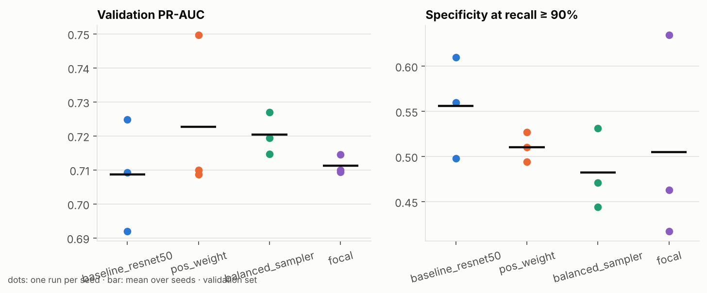

# Phase 4: Class imbalance

**Goal:** find out whether the standard imbalance remedies make the model
better at the job that matters. The yardstick: **how many normal X-rays get
flagged when we insist on catching 90% of fractures** (specificity at recall
0.90 on validation). Phase 3 measured the baseline there: about 53 alarms per
100 X-rays.

**The test set is not used to compare variants.** Picking the best of several
models by their test score would make that score optimistic (we'd be selecting
on noise). Variants are compared on validation; only a winner, if there is one,
gets a single test evaluation with the Phase 3 protocol.

## Results

**Decision (pre-registered rule): the baseline stays.** None of the three
remedies improved specificity at 90% recall; all three were worse on average.
The test set was not touched.

12 runs, 3 seeds each, on Kaggle T4 x2 in 73 min (`results/phase4_imbalance/`).
Mean ± sd over seeds, and Δ is the mean paired difference from the baseline with the same seed.

| Variant | Val PR-AUC | Specificity at recall ≥ 0.90 | Alarms / 100 X-rays | Best epoch |
|---|---|---|---|---|
| **baseline** | 0.709 ± 0.016 | **0.556 ± 0.056** | **52.4 ± 4.6** | 10.3 |
| weighted loss | 0.723 ± 0.023 (Δ +0.014) | 0.510 ± 0.017 (Δ −0.045) | 56.1 (Δ +3.8) | 10.3 |
| balanced sampler | 0.720 ± 0.006 (Δ +0.012) | 0.482 ± 0.044 (Δ −0.074) | 58.5 (Δ +6.1) | 8.0 |
| focal loss | 0.711 ± 0.003 (Δ +0.003) | 0.505 ± 0.114 (Δ −0.051) | 56.6 (Δ +4.2) | 14.3 |



| Variant | Δ specificity | Noise | Δ PR-AUC | Noise | Wins? |
|---|---|---|---|---|---|
| weighted loss | −0.045 | 0.056 | +0.014 | 0.023 | no |
| balanced sampler | −0.074 | 0.056 | +0.012 | 0.016 | no (worse beyond noise) |
| focal loss | −0.051 | 0.114 | +0.003 | 0.016 | no |

### What the numbers say

1. **Rebalancing didn't help where it matters.** All three nudge PR-AUC up by
   0.003–0.014, which is well inside seed noise. At the 90%-recall operating
   point they flag *more* normal X-rays, not fewer. The balanced sampler is
   worse by more than the noise (−0.074).
2. **Why:** PR-AUC is dominated by the confident top of the ranking, which
   rebalancing tidies up a little. Specificity at 90% recall depends on the
   *bottom* of the fracture scores: the 10 hardest fractures the threshold
   has to reach down to. Those images look normal to the model. Re-weighting
   the loss doesn't give it the ability to see them. The class prior was never
   the bottleneck; a tuned threshold already handles it.
3. **The sampler overfits sooner.** Best epoch 8.0 vs 10.3. Each of the 483
   training fractures is repeated ~2.8× per epoch, so the model memorises them
   faster.
4. **Focal loss is the noisiest.** Specificity ranges from 0.42 to 0.63
   across seeds. Focusing on hard examples also focuses on noisy ones (Phase 1
   found label noise), which makes training less stable.
5. **Seed noise is large, and that is a finding in itself.** The baseline
   alone ranges from 0.50 to 0.61 specificity and 0.692 to 0.725 PR-AUC across
   three seeds. A single-run comparison could easily have crowned any of
   these variants. Phase 5 keeps 3 seeds per variant.
6. **No new test evaluation.** The Phase 3 test result (recall 0.892,
   specificity 0.548) remains the reference.

**Implication for Phase 5:** the remaining errors are about what the model
can *see*, not how the loss is weighted. Phase 5 should therefore change
**input resolution** (hairline fractures at 384 px) and the
**architecture/backbone**, compared the same way. Phase 6 (Grad-CAM on the
missed fractures) will show what those hard cases look like.

---

## 1. The variants

All four share everything (model, preprocessing, augmentation, optimiser,
schedule, early stopping on validation PR-AUC). Only the handling of imbalance
differs.

| Variant | Config | What changes |
|---|---|---|
| baseline | `baseline_resnet50.yaml` | Plain BCE; every image counts once (17.6% fractured). |
| weighted loss | `imb_pos_weight.yaml` | Each fractured image's loss × n_normal / n_fractured (≈ 4.7), so both classes weigh the same in total. |
| balanced sampler | `imb_balanced_sampler.yaml` | Batches drawn ~50/50 with replacement; same steps per epoch. Fractures are seen ~2.8× per epoch. |
| focal loss | `imb_focal.yaml` | `(1 − p_t)^γ · BCE`, γ = 2, no class weights: easy images (either class) are down-weighted, hard ones dominate. |

Implementation: `src/fracdet/train/imbalance.py`. The validation loss is
always plain BCE, so `val_loss` stays comparable between variants.

## 2. Experimental design

**3 seeds per variant, baseline re-run too.** One training run per variant
can't separate a real effect from luck: with 102 validation fractures,
seed-to-seed swings of ±0.02 in PR-AUC are normal. All 12 runs use the same
code and the same seeds (42, 43, 44). The Phase 2 run is *not* reused, so the
comparison is like-for-like.

**Paired by seed.** Each variant is compared with the baseline run that has
the same seed (same initial head weights, same augmentation stream), and the
differences are averaged. Pairing removes the part of the variation both runs
share.

**Selection rule, fixed before the sweep** (`configs/sweep_phase4.yaml`):

- Primary metric: validation specificity at the threshold that reaches 90%
  recall (the Phase 3 rule).
- A variant **wins** only if its mean paired gain is larger than the
  seed-to-seed noise (the larger standard deviation of baseline and variant),
  **and** it loses no more than the noise in PR-AUC.
- If several variants win, the one with the largest gain is chosen.
- If none wins, **the baseline stays**. "No improvement" is a valid result.
- The winner's representative checkpoint is its **median** seed, not its best
  seed. The best of 3 would be an optimistic pick.

**What to expect.** Weighting and sampling mostly push fracture scores up,
which a tuned threshold already compensates for. The usual finding is little
change in *ranking*. Focal loss is the one most likely to help our specific
failure: Phase 3 found the hardest fractures scored near 0.

## 3. Running it

```bash
# all 12 runs, one queue per GPU (Kaggle T4 x2), ~2.5 h
python scripts/sweep.py configs/sweep_phase4.yaml --gpus 0,1 --set train.num_workers=2
# validation comparison + decision, from the runs' own files
python scripts/compare_runs.py configs/sweep_phase4.yaml
```

`sweep.py` runs jobs seed-major (all variants for seed 42 first), so a sweep
that stops early still has complete seeds. A failed job is recorded in
`manifest.json` and the sweep continues.

## 4. Interview questions

**Q: Your data is 17% positive. Why not just oversample?**
I tried it, alongside loss weighting and focal loss, under the same budget and
seeds, and judged them on specificity at a fixed recall, because a threshold
already corrects the class prior. Rebalancing that only shifts scores changes
nothing once the threshold is tuned. Only changes in ranking matter.

**Q: What does pos_weight actually do?**
It multiplies the loss of every positive example. With n_neg/n_pos ≈ 4.7, the
total loss from fractures equals the total from normals, so the gradient no
longer mostly says "predict normal".

**Q: How is focal loss different from class weighting?**
Class weighting scales a whole class. Focal loss scales each example by how
wrong the model is: confident correct predictions get almost no weight, so
training concentrates on hard cases from either class. With γ = 0 it is plain
BCE.

**Q: Why three seeds?**
Run-to-run noise from initialisation and data order is the same size as the
effects being measured. With one run per variant, I could "win" by luck.
Three seeds give a mean and a spread, and pairing by seed sharpens the
comparison.

**Q: Why not compare on the test set?**
Choosing the best of four models by test score turns the test set into a
validation set, and the reported number becomes optimistic. Selection happens
on validation; the test set is used once, for the chosen model.

**Q: Why the median seed and not the best one?**
The best of three is partly luck, so its score would overstate what the method
delivers. The median is a fair representative of the method.
