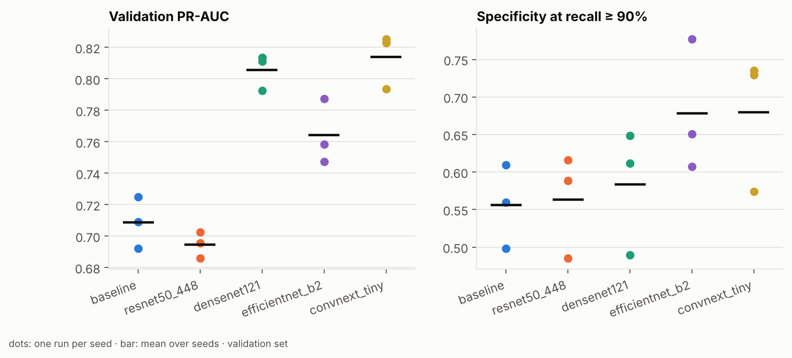

# Phase 5: Model comparison (resolution and backbone)

**Goal:** Phase 4 showed the remaining errors are not about class balance; the
hardest fractures look normal to the model. Phase 5 asks whether a model that
**sees more** does better: more input pixels, or a different architecture or
pretraining. The yardstick is the same as before: validation specificity at
90% recall, 3 seeds per variant, selection rule committed before the runs.

## Results

**Decision (pre-registered rule): ConvNeXt-Tiny replaces ResNet-50**, subject
to its one test evaluation. EfficientNet-B2 also cleared the bar. ConvNeXt-Tiny
had the larger gain, and it is clearly ahead on PR-AUC.

15 runs, 3 seeds each, on Kaggle T4 x2 in 98 min (`results/phase5_models/`).
Values are mean ± sd over seeds, and Δ is the mean paired difference from the baseline with the same seed.

| Variant | Val PR-AUC | Specificity at recall ≥ 0.90 | Alarms / 100 | PR-AUC without hardware | Best epoch | Min / run |
|---|---|---|---|---|---|---|
| baseline (ResNet-50, 384) | 0.709 ± 0.016 | 0.556 ± 0.056 | 52.4 | 0.680 ± 0.021 | 10.3 | 11.5 |
| ResNet-50, 448 | 0.695 ± 0.008 (Δ −0.014) | 0.563 ± 0.069 (Δ +0.008) | 51.8 | 0.654 (Δ −0.026) | 14.0 | 16.0 |
| DenseNet-121 | 0.806 ± 0.011 (Δ +0.097) | 0.583 ± 0.083 (Δ +0.028) | 50.1 | 0.782 (Δ +0.102) | 11.3 | 13.5 |
| EfficientNet-B2 | 0.764 ± 0.021 (Δ +0.056) | 0.678 ± 0.088 (Δ +0.123) | 42.3 | 0.723 (Δ +0.043) | 12.0 | 11.7 |
| **ConvNeXt-Tiny** | **0.814 ± 0.018 (Δ +0.105)** | **0.680 ± 0.091 (Δ +0.124)** | **42.2** | **0.786 (Δ +0.106)** | 6.0 | 8.7 |



| Variant | Δ specificity | Noise | Δ PR-AUC | Noise | Wins? |
|---|---|---|---|---|---|
| ResNet-50, 448 | +0.008 | 0.069 | −0.014 | 0.016 | no |
| DenseNet-121 | +0.028 | 0.083 | +0.097 | 0.016 | no (ranking much better, operating point within noise) |
| EfficientNet-B2 | +0.123 | 0.088 | +0.056 | 0.021 | yes |
| ConvNeXt-Tiny | +0.124 | 0.091 | +0.105 | 0.018 | **yes, larger gain** |

### What the numbers say

1. **The backbone was the bottleneck, not the loss or the resolution.**
   ConvNeXt-Tiny raises validation PR-AUC from 0.709 to 0.814 and cuts false
   alarms at 90% recall from 52 to 42 per 100 X-rays. Phase 4's loss tricks
   moved PR-AUC by at most 0.014; this moves it by 0.105.
2. **The gain is not the metal shortcut.** Without hardware images, ConvNeXt's
   PR-AUC rises from 0.680 to 0.786 (+0.106), the same size as the overall
   gain. It finds fractures better, not metal better.
3. **Resolution did nothing.** ResNet-50 at 448 px is no better than at 384
   (PR-AUC −0.014, within noise). This confirms the Phase 5 design note: the
   images are already ~454 px, so there is little extra detail to recover.
4. **Pretraining matters.** The two biggest PR-AUC gains come from DenseNet-121
   (an X-ray-proven design) and ConvNeXt-Tiny (ImageNet-22k: 14M images
   vs 1.3M). ConvNeXt converges fastest too: best epoch 6 vs 10, and
   8.7 min per run vs 11.5.
5. **DenseNet ranks better but does not win.** Its PR-AUC gain (+0.097) is
   large and consistent, but its specificity at 90% recall swings 0.49–0.65
   across seeds. The operating point depends on the ~10 hardest fractures,
   so it is far noisier than PR-AUC, and the rule requires a gain beyond that
   noise.
6. **EfficientNet-B2 "wins" partly by luck of one seed.** Its specificity is
   0.78, 0.65 and 0.61 across seeds. Its scores also sit extremely low
   (thresholds around 1e-5), which is a calibration warning for deployment.
   ConvNeXt has the same primary gain with far better PR-AUC.
7. **Training is reproducible.** The baseline's three seeds gave identical
   metrics here and in the Phase 4 sweep, two separate Kaggle sessions hours
   apart.
8. **Caveats.** Five candidates were compared on one validation set, so a
   winner can be partly luck; ConvNeXt's own seed 42 is much weaker (0.57)
   than seeds 43/44 (0.73). That is why the winner must still pass its one
   test evaluation before it replaces the baseline. No hyperparameters were
   tuned per backbone.

**Next:** the one-shot test evaluation of ConvNeXt-Tiny's median-seed
checkpoint (seed 44: val specificity 0.729, PR-AUC 0.825) with the Phase 3
protocol. The threshold is tuned on that run's validation predictions and
committed first, then the test set is scored once.

---

## 1. The variants

| Variant | Config | Params | What it tests |
|---|---|---|---|
| baseline | `baseline_resnet50.yaml` | 23.5M | ResNet-50 at 384 px (re-run with the same code and seeds) |
| ResNet-50 at 448 | `p5_resnet50_448.yaml` | 23.5M | **Resolution**: keeps nearly all original pixels |
| DenseNet-121 | `p5_densenet121.yaml` | 7.0M | The CheXNet / MURA backbone for X-rays; dense feature reuse |
| EfficientNet-B2 | `p5_efficientnet_b2.yaml` | 7.7M | A smaller, parameter-efficient model; less room to overfit 2.7k images |
| ConvNeXt-Tiny | `p5_convnext_tiny.yaml` | 27.8M | A modern CNN with ImageNet-22k pretraining (14M images) |

**Why 448 and not 512 or 640.** 91% of FracAtlas images are 373×454 px
(Phase 1). At 384 px the long side shrinks 15%; at 448 almost nothing is
lost. Anything larger only upscales, adding compute but no detail, so a
"bigger is better" sweep would mostly measure interpolation. The ~9% of large
originals (2304×2880) gain detail at 448 too.

## 2. Design

- **Same recipe for every variant.** The optimiser, LR (2e-4), schedule,
  augmentation, batch size, early stopping and seeds are all the same; only
  `model.name` *or* `image_size` changes. A test enforces this.
  **Limitation:** nothing is tuned per backbone. A model that prefers a
  different LR may be under-sold. This is an equal-budget comparison, not a
  best-possible one.
- **Same selection rule as Phase 4** (`configs/sweep_phase5.yaml`): a variant
  wins only if its mean paired gain in specificity at 90% recall exceeds the
  seed noise, without losing PR-AUC beyond its noise. If none wins, the
  baseline stays. The winner is represented by its median seed.
- **Multiple comparisons.** With four challengers, one may clear the bar by
  luck. That is why a winner still gets exactly one test evaluation (Phase 3
  protocol) before it replaces the baseline.
- **Shortcut check (reported, not decisive).** PR-AUC on validation images
  without surgical hardware, per variant. A backbone that wins mostly by
  spotting metal would show a bigger drop there.

## 3. Running it

`notebooks/kaggle_sweep.ipynb` runs any sweep file (set `SWEEP` at the top):

```bash
python scripts/sweep.py configs/sweep_phase5.yaml --gpus 0,1 --set train.num_workers=2
python scripts/compare_runs.py configs/sweep_phase5.yaml
```

15 runs. On Kaggle T4 x2 about 2–3 h (448 px and ConvNeXt are slower than the baseline).

## 4. Interview questions

**Q: Why not just use the biggest model?**
With 2.7k training images, capacity isn't the bottleneck; generalisation is.
A larger model can memorise faster. The comparison measures that directly,
over seeds, instead of assuming it.

**Q: Why did you test 448 px rather than 512 or 640?**
Most images are 454 px on the long side. Resizing beyond the native
resolution invents pixels by interpolation. 448 removes the 15% downscale of
384 without pretending to add detail.

**Q: Why is DenseNet-121 a natural candidate for X-rays?**
It was the backbone of CheXNet (chest X-rays) and of the MURA baseline
(musculoskeletal X-rays, the closest public benchmark to FracAtlas).

**Q: Isn't comparing five models on one validation set risky?**
Yes. The more candidates, the more likely one looks better by chance. I use
3 seeds, a gain threshold set by the seed noise, a rule fixed in advance,
and a single confirming test evaluation for any winner.

**Q: Why the same learning rate for every model?**
To keep the comparison equal-budget and avoid tuning on validation for each
model, which would favour whoever got the most tuning. The downside is
stated: a model that needs a different LR could look worse than it is.
