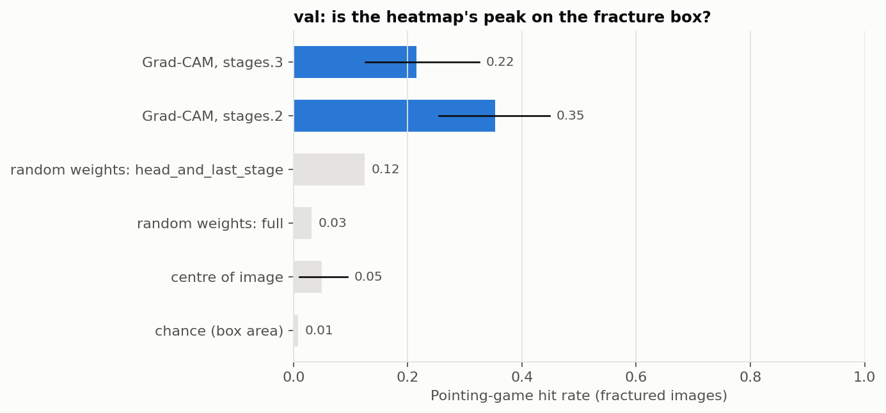
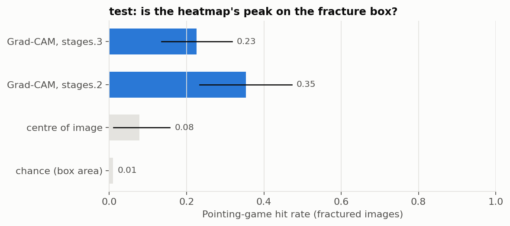
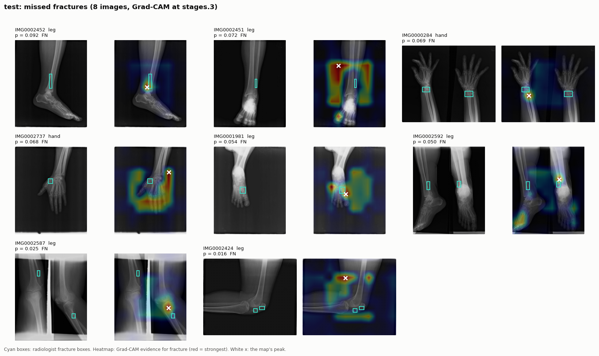
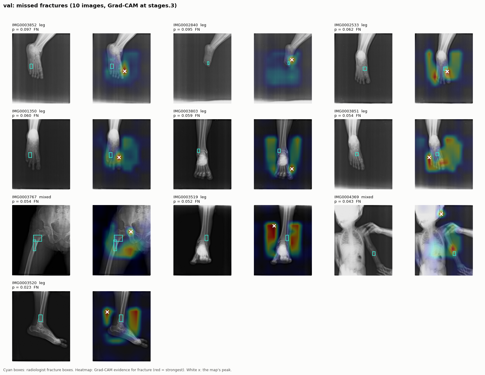

# Phase 6: Explainability (Grad-CAM)

**Goal:** show *where* in the X-ray the model finds evidence of a fracture,
and check that it is the fracture and not something else. A screening tool
that flags an X-ray should be able to point at what it flagged; a model that
scores well while looking at the wrong place has learned a shortcut.

Two questions from Phase 5 drive the case studies:

- Why does the model miss 6 of 30 leg fractures on test?
- Why does it flag most normal hand X-rays (hand specificity 0.30)?

Grad-CAM changes no weights and no threshold. The model is the Phase 5
winner (ConvNeXt-Tiny, seed 44, epoch 4) with its pre-registered threshold 0.0968.

## 1. Method

**Grad-CAM** (Selvaraju et al., 2017), on the fracture logit `z`:

1. Forward pass, keeping the activations `A` of one layer (C maps of h × w).
2. Gradient `dz/dA`.
3. Channel weight `w_c` = that gradient averaged over the h × w grid: how much
   channel c, as a whole, argues for "fracture".
4. Map = ReLU(Σ_c w_c · A_c), upsampled to the input size.

Red therefore means "evidence for fracture". A map with no positive value
anywhere (nothing argued for fracture) is called *empty*.

- **Layer.** The last stage, `stages.3`, the standard choice nearest the
  decision. At 384 px it is a 12 × 12 grid, so one cell covers 32 × 32 pixels.
  `stages.2` (24 × 24) is also computed and reported, but no claim rests on it.
- **Batches.** One backward pass on the sum of the logits gives every image
  its own Grad-CAM, because in eval mode no layer mixes images. A test checks
  this against one-image-at-a-time results.
- **Precision.** fp32, not mixed precision: small gradients can underflow in fp16.
- **Frame.** Maps are computed in the model's 384 px letterbox. The padding
  is excluded from every score, and `explain_image()` maps a heatmap back
  onto the original X-ray (the web app in Phase 8 uses it).

Code: `src/fracdet/explain/` (`gradcam.py`, `localize.py`, `sanity.py`,
`pipeline.py`, `figures.py`), `scripts/explain.py`, `notebooks/kaggle_explain.ipynb`.

## 2. How "is it looking at the fracture?" is measured

FracAtlas ships radiologist boxes around every fracture (Phase 1: one box per
fracture, 719 / 719). The classifier never saw them; here they are only used
as ground truth.

- **Pointing game (primary).** A *hit* if the map's single hottest pixel lies
  inside a fracture box, with no tolerance margin. Reported as the hit rate
  over fractured images, with 95% intervals that resample patient groups.
- **Energy in box (secondary).** The share of the map's total mass inside the
  boxes. A map that peaks on the fracture but spreads everywhere else scores low.

Every number is read against three baselines:

| Baseline | What it is | Why |
|---|---|---|
| chance | the share of the image the boxes cover | a random point hits a box with this probability; a flat map has this energy share |
| centre | "always point at the middle of the image" | X-rays are framed on the injury, so this is a real, model-free competitor |
| random weights | the same network re-initialised (below) | rules out maps that show the image's edges rather than what was learned |

**Sanity check** (Adebayo et al., 2018). On 64 fractured validation images,
the maps are recomputed with (a) the head and last stage re-initialised and
(b) the whole network re-initialised. If Grad-CAM reflects the trained model,
the rank correlation with the trained maps should fall towards 0, and the
random models' hit rate towards chance.

## 3. Pre-registration

`configs/explain.yaml` fixes the layers, metrics, baselines, the sanity check
and **which images go into each figure**, and it was committed before any map
was computed. The test run refuses to start if that file is uncommitted or
edited. Grad-CAM cannot change the model, but the analysis could still be
tuned to the test set (trying layers or metric definitions until the test
heatmaps look good). Committing the plan first rules that out.

Galleries, chosen by rule rather than by eye:

| Figure | Images |
|---|---|
| missed fractures | every fracture below the threshold (FN), all of them |
| found fractures | 12 random true positives |
| hand false alarms | the 12 most confident false alarms on normal hands |
| other false alarms | the 12 most confident false alarms elsewhere |
| hardware | 12 random images with surgical hardware |
| cleared normals | 12 random true negatives |

The run also checks that it reproduces the committed Phase 5 outcomes
exactly (the same TP / FP / TN / FN counts on validation and test), so every
image keeps the label it had in the Phase 5 results.

## 4. Running it

```bash
python scripts/explain.py --find-run p5_convnext_tiny_s44 --split val
python scripts/explain.py --find-run p5_convnext_tiny_s44 --split test
```

On Kaggle: `notebooks/kaggle_explain.ipynb`, with the FracAtlas dataset and
the Phase 5 sweep output as inputs. Outputs go to
`outputs/explain/<run>/<split>/`; the summaries and figures are copied to
`results/phase6_explain/`.

## 5. Results

**In short:** the heatmaps follow the fracture far more often than any
baseline, they depend on the trained weights, and every missed fracture is a
case where the model looked somewhere else. On X-rays with surgical hardware
the heatmaps sit on the metal.

Kaggle notebook `notebook2ac59126bb`, version 7, T4 (`results/phase6_explain/`, with
provenance and checksums in its README).
Both splits reproduced the committed Phase 5 outcome counts exactly
(validation TP 92 / FP 131 / TN 353 / FN 10; test 94 / 142 / 345 / 8). The
plan was committed in `0e52ac7` before the run.

### Pointing game (fractured images, 95% CIs over patient groups)

| | Validation (102) | Test (102) |
|---|---|---|
| **Grad-CAM, `stages.3` (primary)** | **0.216** [0.126, 0.325] | **0.225** [0.135, 0.318] |
| Grad-CAM, `stages.2` (secondary) | 0.353 [0.255, 0.449] | 0.353 [0.233, 0.472] |
| centre of the image | 0.049 [0.011, 0.094] | 0.078 [0.010, 0.157] |
| chance (box share of the image) | 0.008 | 0.010 |
| heatmap mass inside the boxes, `stages.3` | 7.0% (boxes cover 0.8%) | 7.8% (boxes cover 1.0%) |





- **Far above every baseline.** About 1 peak in 5 lands exactly in the box.
  The boxes cover only about 1% of the image, so chance is 1 in 100, and the
  "look at the centre" guess gets 1 in 13. The lower end of the test
  interval (0.135) is above chance and above the centre guess's point
  estimate (0.078), and test agrees with validation.
- **It is a strict test.** One pixel, no margin, at a 32 px grid. Many misses
  in the gallery are on the same bone a short distance from the box, which
  the strict score counts as a miss.
- **The finer layer hits more often** (0.35 vs 0.22). This was a secondary,
  pre-declared comparison, so it is a lead for Phase 7 (localization), not
  a claim.

### Missed fractures: the model was not looking at them

| | Validation | Test |
|---|---|---|
| Found fractures (TP), hit rate | 0.239 (92) | 0.245 (94) |
| **Missed fractures (FN), hit rate** | **0 / 10** | **0 / 8** |

Not one of the 18 missed fractures had its heatmap peak on the fracture.
The misses are failures to *find* the fracture, not fractures the model
found and then scored too low. Lowering the threshold would catch some of
them only by flagging many more normal X-rays; the model needs to *see* them.

**14 of the 18 misses are leg X-rays** (validation 8 of 10, test 6 of 8),
which matches the leg recall drop found in Phase 5. In the galleries, most are
feet and ankles, and the heat often spreads over the dark background beside
the leg or onto a neighbouring bone, with the peak on the wrong joint or just
beside a small box.





### Sanity check: the maps depend on the trained weights

On 64 fractured validation images (trained hit rate 0.219 on these):

| Weights re-initialised | Rank correlation with trained maps | Hit rate |
|---|---|---|
| head + last stage | 0.350 | 0.125 |
| whole network | 0.136 | 0.031 |

With the whole network random, the maps share little with the trained ones,
and the hit rate falls to near the baselines. Grad-CAM passes the
Adebayo test. With only the last stage random, a moderate correlation
remains, as expected: the last stage still receives features from the
trained earlier stages, so part of the map's layout survives.

### What the galleries show (visual, not measured)

These observations come from the pre-declared 12-image galleries. They
are leads to test, not findings.

- **Hardware.** On images with plates, rods or screws, the heat lies along
  the metal ([figure](figures/phase-6/test_hardware.png)). The model uses implants as evidence.
  Phase 5 showed this is not the whole story (PR-AUC 0.825 without
  hardware images), but a deployed tool must not treat a healed, plated
  bone as a new fracture.
- **Hand false alarms.** The most confident ones are mostly side
  (lateral) views of the wrist and forearm, with the heat on the wrist,
  where bones overlap. Distal-radius fractures are common there, so the
  model seems to have learned "wrist on a side view" as a fracture
  location. That fits Phase 5's low hand specificity
  ([figure](figures/phase-6/test_hand_false_alarms.png)).
- **Other false alarms.** The peaks sit at the ends of long bones (knee,
  ankle, elbow). Several of these X-rays look like children's limbs, where
  growth plates are at those positions and can resemble a fracture line.
  The dataset has no age field, so this cannot be checked directly
  ([figure](figures/phase-6/test_other_false_alarms.png)).
- **Found fractures.** When the peak misses the box, it is usually on the
  same bone nearby. When the X-ray shows two views side by side, the heat
  often goes to one view only
  ([figure](figures/phase-6/test_found_fractures.png)).

### What this means for the next phases

- **Phase 7 (localization)** is worth doing. Grad-CAM points at the right
  area well above chance, but not precisely enough to *mark* a fracture.
  The boxes exist, and the finer layer already hits more often.
  ([Done](phase-7-localization.md): a trained detector's top box hits 0.745.)
- **Phase 8 (app)** should show the heatmap as "where the model looked",
  not "where the fracture is", and should warn when hardware is present.
  ([Done](phase-8-app.md): the app labels it "Where the model looked", and its
  "Reading the result" section warns that plates and screws mislead both models.)

The full tables, including per-region rates, are in
`results/phase6_explain/{val,test}/report.md`.

## 6. Interview questions

**Q: What does Grad-CAM actually show?**
Where the activations of the last convolutional stage were, weighted by how
much each channel pushed the fracture score up. It shows the region the model
relied on, at the resolution of that layer (32 px cells here). It does not
show the fracture line, and it does not prove the model "understands" bone.

**Q: Why not just show a few nice heatmaps?**
A handful of hand-picked maps proves nothing: there is always a good-looking
example. I score every fractured image against the radiologist boxes, compare
with baselines that need no model, and choose the figures by a fixed rule,
including the failures.

**Q: Why compare with a "centre of the image" baseline?**
X-rays are framed on the injured area, so the fracture is often near the
middle. A heatmap that simply peaks in the middle would score well without
learning anything. Grad-CAM has to beat that, not only random chance.

**Q: What is the randomisation sanity check?**
Adebayo et al. showed that some saliency methods give almost the same maps for
a trained and an untrained network, so those maps were edge detectors. If
Grad-CAM maps change completely when the weights are scrambled, they reflect
what the model learned.

**Q: Why the last stage and not an earlier, sharper one?**
The last stage is closest to the decision, so its map explains the decision.
Earlier stages have finer grids but describe more generic features (edges,
textures). I compute one earlier stage too, but the claims rest on the
standard choice made in advance.

**Q: Could looking at test heatmaps leak information?**
Not into the model: Grad-CAM changes no weights or threshold. It could leak
into the analysis, if I kept adjusting it until the test maps looked good.
That is why the plan was committed first and the test run refuses to start
otherwise.

**Q: Your boxes are for classification images. Is the pointing game fair?**
It is a strict test: one pixel, no margin, at a 32 px resolution. Small
fractures (a box of a few dozen pixels) are hard to hit even when the model
looks at the right bone. That is why the chance and centre baselines are
reported per image, and energy share is reported next to it.

---

<!-- nav -->
← [Phase 5: Model comparison (resolution and backbone)](phase-5-models.md) · [Project README](../README.md) · [Phase 7: Localisation (fracture boxes)](phase-7-localization.md) →
