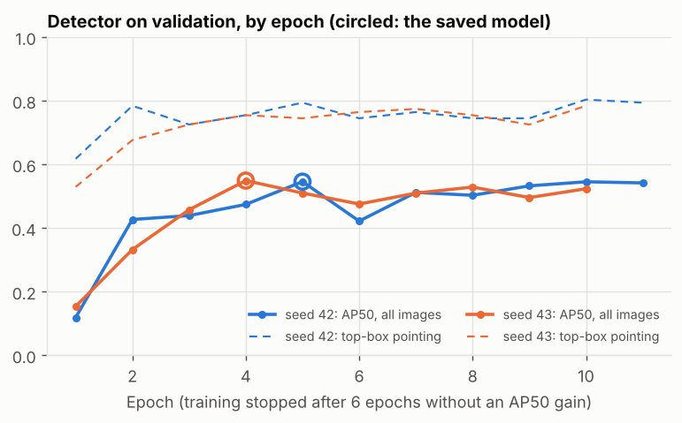
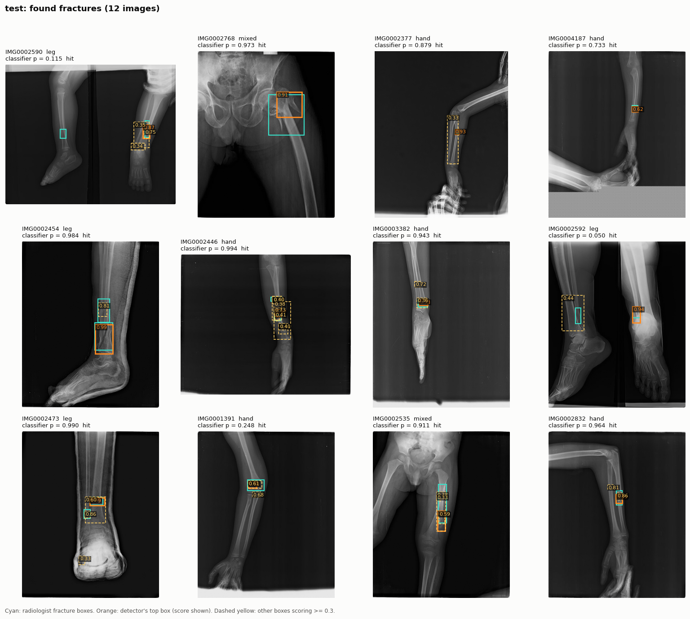
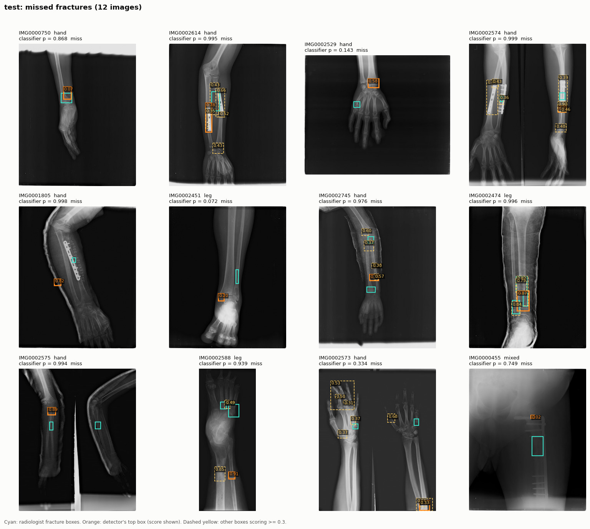
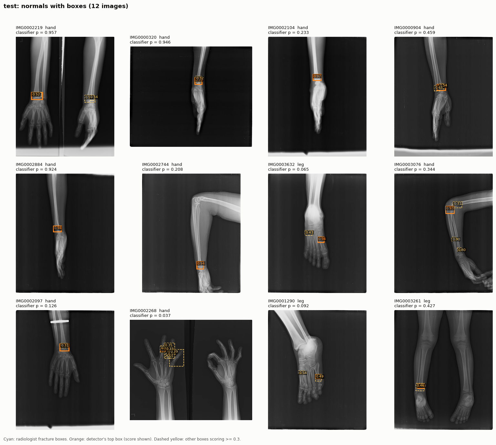

# Phase 7: Localisation (fracture boxes)

**Goal:** mark *where* the fracture is. Phase 6 showed the classifier's
Grad-CAM heatmap peaks on the fracture box in about 1 of 5 fractured X-rays.
That is far above chance, but it is not enough to point a reader at the
fracture. Phase 7 trains a detector on the radiologist boxes, and Grad-CAM
boxes are the baseline it must beat.

The system stays two-stage: the Phase 5 classifier decides "fracture or not"
(threshold 0.0968, recall first). The detector marks where. The app (Phase 8)
shows the detector's boxes on X-rays the classifier flags.

## 1. The detector

**Faster R-CNN v2** (torchvision, ResNet-50 + FPN), starting from COCO
detection weights, with a 2-class head (background, fracture).

- **Backbone + FPN:** feature maps at several scales, so a small fracture and
  a long fracture line both have a resolution that suits them.
- **Region Proposal Network:** proposes boxes that probably contain *something*.
- **RoI head:** for each proposal, classifies fracture vs background and refines
  the box.
- **Four losses** are trained together: RPN objectness and box regression, head
  classification and box regression.

**Why torchvision, not YOLO:** it is plain PyTorch I can read and explain line
by line, it fits the existing package, and its BSD licence is safe for a
deployed app. Ultralytics YOLO is often stronger out of the box, but it is
AGPL-3.0 and hides its training loop. **Why COCO weights:** COCO has no X-rays,
but a model that already knows how to propose and refine boxes needs far fewer
examples. FracAtlas has only ~500 fractured training images.

**Input.** Grayscale with the same decode as the classifier, no letterbox (the
detector resizes itself). The short side goes to 800 px. Most X-rays are
373 × 454, so a typical fracture box (~1% of the image, ~45 px) grows to
~90 px, a size the FPN anchors handle well.

**Training data per epoch:** every fractured training image, plus the same
number of normal ones drawn afresh each epoch. Normal X-rays teach the
detector what *not* to box. Augmentation: horizontal flip (boxes flipped with
the image), brightness and contrast.

**Recipe:** SGD, LR 0.005 (the reference 0.02 for batch 16, scaled to batch 4),
1 warmup epoch, cosine decay, mixed precision, 24 epochs at most. The epoch is
chosen by validation AP50, with early stopping after 6 epochs without gain.
The test split is never loaded during training.

Code: `src/fracdet/detect/` (`data.py`, `model.py`, `train.py`, `metrics.py`,
`gradcam_boxes.py`, `evaluate.py`, `figures.py`), `scripts/train_detector.py`,
`scripts/evaluate_detector.py`, `scripts/kaggle_phase7.sh`.

## 2. How it is measured

All boxes are compared in normalised image coordinates (0..1). IoU does not
change under a per-axis resize, so the numbers do not depend on how big the
detector made the image.

| Metric | Meaning |
|---|---|
| **AP50, all images (primary)** | Area under the precision-recall curve, a box counting as correct at IoU ≥ 0.5. Normal X-rays are included, so a box on a healthy bone is a false positive |
| AP50, fractured images only | How most papers report it (no normal X-rays) |
| AP at IoU 0.25 | FracAtlas boxes are tight; a box overlapping a quarter is often on the right fracture |
| FROC | Share of fracture boxes found at 0.5 / 1 / 2 false boxes per image: the radiology way to read a detector |
| Top-1 pointing | The highest-scoring box's centre lies in a fracture box: **the Phase 6 pointing game**, so detector and Grad-CAM are compared on the same test |
| Top-1 IoU ≥ 0.5 | The top box really outlines the fracture |
| End to end | Of the fractures the classifier flags, how many get a correct top box |

95% intervals resample patient groups, as in Phases 3–6. Matching is COCO
style: predictions in score order, each takes the unmatched fracture box it
overlaps most. A second box on an already-found fracture is a false positive.

**Baseline: Grad-CAM boxes.** No box training. Threshold the classifier's
Phase 6 heatmap at half its peak, take the connected region around the peak,
and box it, scoring it with the classifier's probability. This is
"localisation for free". The detector has to beat it to earn its place.

## 3. Pre-registration

`configs/detect.yaml` fixes the model, the recipe, the epoch rule, the
metrics, the baseline and the galleries, and was committed before training.

- **Two seeds, one reported model.** Seeds 42 and 43 train in parallel (one
  per GPU). Seed 42 is the model that is evaluated on test. Seed 43 is
  reported on validation only, to show how much a re-run moves the numbers.
  Picking the better seed on validation would be a selection step, so
  neither is picked.
- **Test once.** `scripts/evaluate_detector.py --split test` refuses to run if
  the plan is uncommitted or edited, if the seed is not the pre-registered
  one, or if test results are already committed (unless a re-run reason is
  recorded).
- **The classifier is checked too.** The run must reproduce the committed
  Phase 5 TP / FP / TN / FN counts before any metric is computed.

## 4. Running it

On Kaggle (T4 x2), one script does everything: trains both seeds, evaluates
both on validation, evaluates seed 42 on test, and zips the results.

```bash
bash scripts/kaggle_phase7.sh
```

Inputs: the FracAtlas dataset and the Phase 5 sweep output (for the
classifier). The script also saves the reported detector's weights,
`detector_s42_best.pt`, for the Phase 8 app.

## 5. Results

**In short:** the detector's top box lands on the fracture in **3 of 4** test
fractures (Grad-CAM: under 1 in 3), and it finds **64% of fracture boxes at one
false box per image**. Its weak spot is surgical hardware: it boxes the
implant. The Grad-CAM box baseline is far behind on every score.

Kaggle notebook `notebook2ac59126bb`, version 8 (T4 x2, 44 min, code
`8b67243`, the commit that also holds the plan). Both splits reproduced the
committed Phase 5 classifier counts exactly. Files, checksums and provenance:
`results/phase7_detect/`.

### Training

| | Seed 42 (reported) | Seed 43 |
|---|---|---|
| Best epoch (of 24 allowed) | 5 | 4 |
| Epochs run (early stop) | 11 | 10 |
| Validation AP50, all images | 0.546 | 0.549 |
| Validation top-box pointing | 0.794 | 0.755 |
| Normal X-rays with a box scoring ≥ 0.5 | 0.26 per image | 0.10 per image |



Validation AP50 climbs for 4–5 epochs, then levels off near 0.55 with
epoch-to-epoch swings of about ±0.05. That is a plateau, not a collapse:
with ~500 fractured training X-rays the detector learns what it can quickly.
The two seeds agree closely on AP50; they differ more in how many boxes they
put on normal X-rays.

### Test (scored once, seed 42; 589 X-rays, 102 fractured, 148 fracture boxes)

| Metric | Detector [95% CI] | Grad-CAM boxes |
|---|---|---|
| **AP50, all images (primary)** | **0.421** [0.296, 0.528] | 0.001 [0.000, 0.003] |
| AP50, fractured images only | 0.508 [0.388, 0.615] | 0.001 |
| AP at IoU 0.25, all images | 0.553 [0.418, 0.663] | 0.024 |
| Fracture boxes found at 0.5 / 1 / 2 false boxes per image | 0.554 / **0.635** [0.535, 0.746] / 0.703 | 0.014 / 0.014 / 0.014 |
| **Top box centre in a fracture box** (Phase 6 test) | **0.745** [0.650, 0.837] | 0.304 [0.203, 0.410] |
| Top box IoU ≥ 0.5 | 0.559 [0.440, 0.670] | 0.020 |

Validation (seed 42) for comparison: AP50 0.546 [0.420, 0.654], top-box
pointing 0.794, 0.721 of boxes at one false box per image.

- **Far ahead of the baseline.** Grad-CAM boxes are almost never tight enough
  to count (the half-peak region on a 12 × 12 grid covers far more than the
  fracture), and even their centre lands on the fracture only 30% of the time.
  The detector's top box does so 75% of the time.
- **Test is below validation**, with overlapping intervals (AP50 0.42 vs
  0.55). Part of the gap is expected: the epoch was chosen by validation
  AP50, which flatters validation a little. The pointing rate held up
  (0.79 → 0.75).
- **By region (test, top-box pointing):** hand 0.741 (54), leg 0.767 (30),
  mixed 0.706 (17). The leg problem of Phases 5–6 does not carry over: a
  detector trained on boxes finds leg fractures as well as hand ones.

### End to end (classifier decides, detector marks)

| | Validation | Test |
|---|---|---|
| Fractures | 102 | 102 |
| Flagged by the classifier | 92 | 94 |
| ...and the top box on the fracture | 74 | 72 |
| ...and the top box outlining it (IoU ≥ 0.5) | 64 | 54 |

Of the test fractures the classifier flags, the detector marks **72 of 94**
correctly (77%).

### Where it fails

From `test_per_image.csv` and the galleries (selection fixed in the plan):

- **Surgical hardware.** Only **4 of 11** test fractures with plates or screws
  get the top box on the fracture (non-hardware: 0.79). In the gallery the top
  box sits on the implant. Hardware images are 7 of the 26 misses. The
  classifier had the same habit (Phase 6), and the app must say so.
- **Near misses are rare.** Only 5 of the 26 missed top boxes overlap a
  fracture box at all. When the detector misses, its top box is usually
  somewhere else in the image, not just beside the fracture.
- **Confident boxes on normal X-rays** sit on the wrist of side views and on
  ankles, the same places the classifier's false alarms pointed to in Phase 6.
  About 1 normal X-ray in 5 gets a box scoring ≥ 0.5 (99 of 487). The
  classifier clears 46 of those 99, which is why the app shows boxes only on
  X-rays the classifier flags, never on their own.







(In these three figures, a top box's score label can be hidden under another
box's label; the drawing order was fixed afterwards in `figures.py`. The
scores themselves are in `test_detections.csv`.)

### What this means for Phase 8

- Use **seed 42, epoch 5** (`detector_s42_best.pt`, 166 MB, kept outside git).
- Show the detector's top box on X-rays **the classifier flags**, labelled as
  "most likely fracture location", with further boxes above a score cut-off
  chosen on validation, not test.
- Warn when the X-ray contains hardware: boxes there are unreliable.

## 6. Interview questions

**Q: Why train a detector when you already have Grad-CAM?**
Grad-CAM shows where the classifier looked, at 32 px resolution, and Phase 6
measured that its peak is on the fracture in about 1 of 5 cases. A detector is
trained on the boxes themselves, so it learns to outline fractures, not just
to find the most suspicious region. I kept Grad-CAM boxes as the baseline to
show the gain is real.

**Q: Why keep the classifier at all, if the detector also scores boxes?**
The classifier was selected and tested for one job: recall-first screening at
a pre-registered threshold. Using the detector's top score as the decision
would mean a new, untested operating point. Two stages also make the app's
logic simple: the classifier says *whether*, the detector says *where*.

**Q: Why include normal X-rays in AP?**
In use, the detector will see healthy bones. A detector that draws boxes on
them would look perfect on fractured-only AP. Counting those boxes as false
positives keeps the metric honest; the fractured-only number is reported next
to it for comparison with papers.

**Q: What is FROC and why report it?**
Free-response ROC: how many fractures are found if you accept on average one
false mark per X-ray (or 0.5, or 2). A radiologist can judge "finds 70% of
fractures at one false mark per image" directly; an AP of 0.4 is harder to picture.

**Q: Why two seeds but only one tested?**
One run can be lucky or unlucky. The second seed shows the run-to-run spread
on validation. Testing both and quoting the better one would be choosing on
the test set; choosing on validation would be a selection that needs its own
confirmation. Fixing seed 42 in advance avoids both.

**Q: Why horizontal flip but no rotation or crop?**
A flip keeps every box an exact box. Rotating a box makes it a larger, looser
box, which teaches sloppy outlines. A random crop can cut a fracture in half
while its label stays. FracAtlas is small, so I kept augmentation simple and safe.

---

<!-- nav -->
← [Phase 6: Explainability (Grad-CAM)](phase-6-explainability.md) · [Project README](../README.md) · [Phase 8: The web app (Fracture Check) and Docker](phase-8-app.md) →
